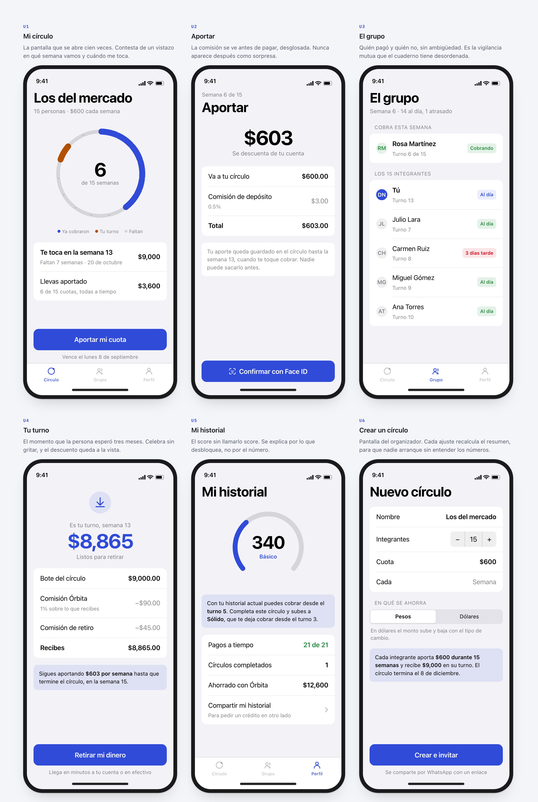
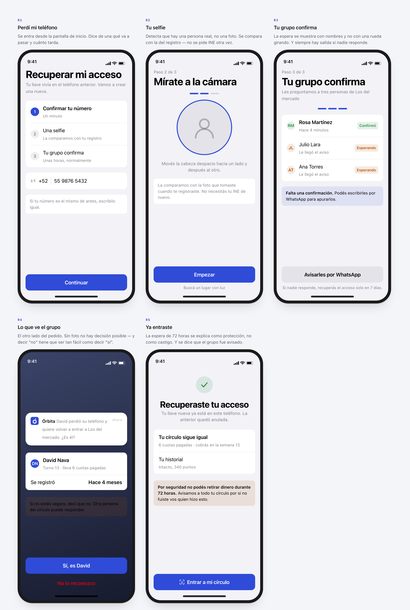

<p align="center">
  
</p>

<h1 align="center">Órbita</h1>

<p align="center">
  Ahorro colaborativo para trabajadores informales en LatAm, sobre Stellar y Soroban.<br>
  <b>La plataforma nunca toca el dinero — y por eso puede existir.</b>
</p>

**Estado:** sin código todavía. Fase de diseño.

---

## Qué es

Un grupo de 5 a 15 personas que ya se conocen aporta una cuota fija cada semana.
Cada semana, una persona recibe el total. Cuando todos cobraron, la órbita se
completa.

Es la mecánica del ahorro rotativo que ya funciona en toda Latinoamérica, con
una diferencia: **el dinero no lo guarda nadie.** Lo retiene un contrato que
libera fondos solo según el orden pactado.

---

## El problema

**El ahorro rotativo se rompe siempre en el mismo punto: la custodia.** Alguien
tiene que juntar el dinero de todos, y esa persona puede desaparecer con el
bote. Es la razón principal por la que la gente le tiene miedo a las tandas, y
ninguna app de notas lo resuelve.

**Quien ahorra así no construye historial.** Más del 60% de los trabajadores
informales en LatAm no tiene historial crediticio. Años de disciplina de pago no
dejan rastro utilizable en ningún lado.

**Y hay un muro regulatorio que bloquea la solución obvia.** En México
participar en una tanda es legal, pero una plataforma que junte el dinero de sus
usuarios cae en **captación irregular de recursos** (Art. 103 de la Ley de
Instituciones de Crédito). La licencia que lo habilitaría —IFPE bajo la Ley
Fintech— exige 5 millones de UDIS (≈35 millones de pesos) de capital mínimo.

Por eso el problema no es construir la app. Es construirla sin custodiar.

---

## Cómo se resuelve

El dinero vive en un contrato Soroban cuyas reglas de liberación se escriben
antes del primer depósito, y cada usuario controla su propia llave mediante
passkey.

### Los tres mecanismos de confianza

| Mecanismo | Qué hace |
|---|---|
| **Reputación portable** | Score on-chain no transferible ni borrable. Quien defrauda no puede estrenar identidad limpia. Exportable vía API con consentimiento: historial crediticio para quien nunca tuvo uno |
| **Exposición neta acotada** | La posición en la rueda deja de ser sorteo y pasa a ser decisión de riesgo. Sin historial se cobra tarde o se deposita garantía; con historial limpio se cobra temprano sin depositar nada |
| **Fondo de Protección** | Cobertura parcial (70% de la cuota incumplida, máximo dos eventos por círculo) financiada por el rendimiento de las garantías. Órbita no puede retirarlo |

### La regla que gobierna los contratos

```
exposición neta = recibido − aportado − garantía
regla:           exposición neta ≤ límite(score)
```

De ahí salen la posición asignada y el colateral exigido.

### Acceso

Móvil, con passkey (huella o Face ID) y sin frase semilla — soporte nativo de
Stellar desde el Protocolo 21. El usuario nunca ve las palabras *wallet*,
*frase semilla*, *gas* ni *XLM*: ve pesos, una rueda con el turno de cada quien,
y un botón. Órbita patrocina las comisiones de red.

### Lo que no resuelve

Los círculos se forman entre personas que ya se conocen — familia, vecinos del
mercado, compañeros de trabajo. Órbita amplifica una confianza preexistente; no
la fabrica entre desconocidos.

---

## Diseño

Construido sobre las Human Interface Guidelines de Apple: tipografía del sistema,
listas agrupadas, títulos grandes y un solo acento. La persona que usa esto
ahorra $600 por semana y nunca oyó la palabra blockchain — no aparecen las
palabras *wallet*, *gas*, *XLM* ni *frase semilla* en ninguna pantalla.

### La marca

El símbolo es una **Ó cuyo acento es el turno**. Nace del nombre, y el punto
ámbar es el mismo color que marca tu semana dentro de la app.


### Entrar

Teléfono, código por WhatsApp, creación de la llave con Face ID y verificación
de identidad. La passkey no es solo un login: **es la clave que firma las
transacciones en la red**, y vive en el chip seguro del teléfono.


### Uso diario

La rueda contesta de un vistazo las dos preguntas que importan: en qué semana
vamos y cuándo me toca. Toda comisión se muestra desglosada antes de confirmar,
nunca después.



### Recuperar el acceso

Si el teléfono se pierde, la llave se pierde con él. La recuperación usa el
factor más fuerte disponible y que ningún banco tiene: **el grupo**. Dos
integrantes confirman que sos vos, y el retiro queda congelado 72 horas por si
alguien te suplantó.



---

## Encuadre legal

**La auto-custodia no es una elección estética: es la condición que hace viable
al producto.** Órbita no capta recursos porque estructuralmente no puede
hacerlo — provee software, no intermediación financiera.

Dos rasgos del diseño sostienen esa línea, y ninguno es negociable:

1. **Órbita no paga rendimiento a sus usuarios.** La garantía se devuelve
   íntegra y nada más. Pagar intereses a quien deposita es justamente lo que
   caracteriza a la actividad bancaria.
2. **El rendimiento generado por las garantías va al Fondo de Protección, y
   Órbita no puede retirarlo en ningún caso.** Es la evidencia de que no hay
   intermediación, no una limitación autoimpuesta.

### Restricciones de lenguaje

Aplican al código, a la interfaz y a cualquier material público:

| Nunca | Por qué |
|---|---|
| "tanda", "cundina" | Cargan el estigma de las advertencias de Condusef y evocan el modelo de organizador-que-junta-el-dinero |
| "caja de ahorro" | Término con connotación regulatoria específica (sociedades cooperativas de ahorro y préstamo) |
| "seguro" | Actividad regulada. El Fondo de Protección es un fondo de contingencia, y así debe describirse |

Se dice **círculo de ahorro**: un acuerdo entre pares ejecutado por software que
ninguna de las partes puede alterar.

> **Advertencia:** este análisis **no sustituye asesoría legal**. Debe validarse
> con un despacho especializado en regulación financiera mexicana antes de
> operar con dinero real.

---

## Stack

| Capa | Tecnología |
|---|---|
| Cliente | React Native (Expo) · JavaScript |
| Plataformas | Android como mercado principal, iOS en paralelo |
| Piso de dispositivo | Android 10+ · iOS 15+ |
| Contratos | Soroban (Rust) |
| Autenticación | Passkeys / smart wallets de Stellar — sin frase semilla |
| Rendimiento | [Blend](https://www.blend.capital/) — soporta USDC, XLM, EURC y AQUA |
| Rampa fiat | Anchors de Stellar para entrada y salida a moneda local |

Una sola identidad visual en ambas plataformas. Lo que se adapta es la
envoltura del sistema: tipografía (SF en iOS, Roboto en Android), gesto de
volver, barra inferior y realimentación táctil.

> **Riesgo abierto:** el SDK oficial [passkey-kit](https://github.com/stellar/passkey-kit)
> está construido sobre WebAuthn, que no existe en React Native. Las piezas
> nativas existen ([react-native-passkey](https://www.npmjs.com/package/react-native-passkey),
> verificación secp256r1 en Soroban desde el Protocolo 21) pero el pegamento
> entre ambas hay que escribirlo. **Se prueba en un spike antes de construir
> cualquier interfaz.**

### Estructura prevista

```
contracts/     Contratos Soroban
  circulo/     Ciclo de aportes, turnos y liberación
  garantia/    Colateral y cálculo de exposición neta
  reputacion/  Score no transferible
  fondo/       Fondo de Protección
app/           Cliente móvil
```

---

## Desarrollo

Todo el trabajo inicial va contra **testnet**, sin dinero real, hasta contar con
opinión legal por escrito.

La documentación de negocio no se versiona acá — vive fuera del repo.
