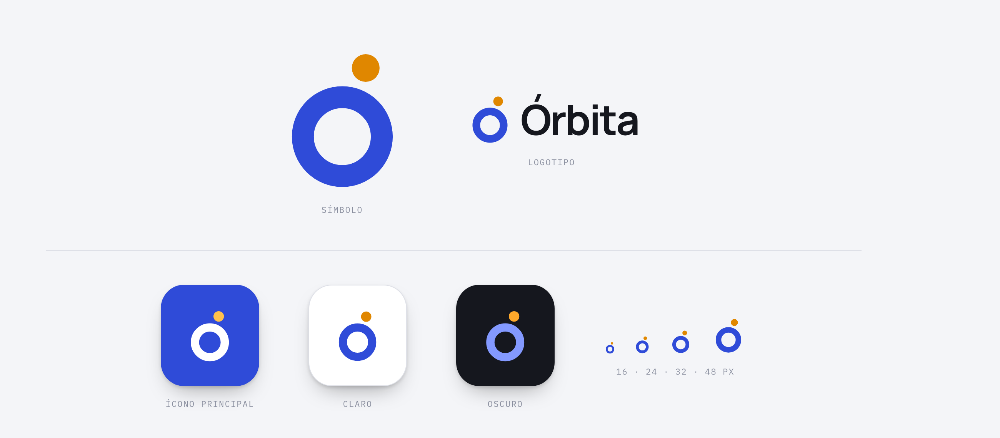
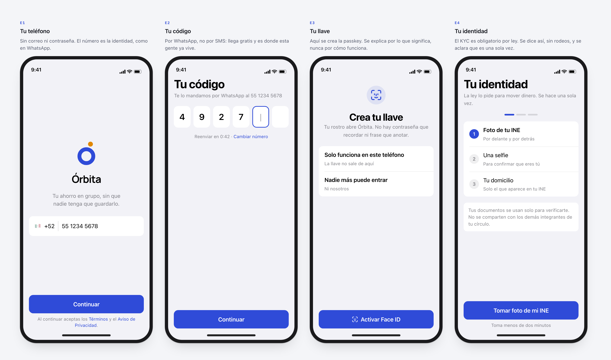

<p align="center">
  
</p>

<h1 align="center">Órbita</h1>

<p align="center">
  Ahorro colaborativo para trabajadores informales en LatAm, sobre Stellar y Soroban.<br>
  <b>La plataforma nunca toca el dinero — y por eso puede existir.</b>
</p>

**Estado:** base del proyecto creada (app y contratos compilan). Siguiente paso:
el spike de passkeys, Etapa 0 del [roadmap](#roadmap).

---

## Qué es

Un grupo de 5 a 15 personas que ya se conocen aporta una cuota fija cada semana.
Cada semana, una persona recibe el total. Cuando todos cobraron, la órbita se
completa.

Es la mecánica del ahorro rotativo que ya funciona en toda Latinoamérica, con
una diferencia: **el dinero no lo guarda nadie.** Lo retiene un contrato que
libera fondos solo según el orden pactado.

---

## El problema

**El ahorro rotativo se rompe siempre en el mismo punto: la custodia.** Alguien
tiene que juntar el dinero de todos, y esa persona puede desaparecer con el
bote. Es la razón principal por la que la gente le tiene miedo a las tandas, y
ninguna app de notas lo resuelve.

**Quien ahorra así no construye historial.** Más del 60% de los trabajadores
informales en LatAm no tiene historial crediticio. Años de disciplina de pago no
dejan rastro utilizable en ningún lado.

**Y hay un muro regulatorio que bloquea la solución obvia.** En México
participar en una tanda es legal, pero una plataforma que junte el dinero de sus
usuarios cae en **captación irregular de recursos** (Art. 103 de la Ley de
Instituciones de Crédito). La licencia que lo habilitaría —IFPE bajo la Ley
Fintech— exige 5 millones de UDIS (≈35 millones de pesos) de capital mínimo.

Por eso el problema no es construir la app. Es construirla sin custodiar.

---

## Cómo se resuelve

El dinero vive en un contrato Soroban cuyas reglas de liberación se escriben
antes del primer depósito, y cada usuario controla su propia llave mediante
passkey.

### Los tres mecanismos de confianza

| Mecanismo | Qué hace |
|---|---|
| **Reputación portable** | Score on-chain no transferible ni borrable. Quien defrauda no puede estrenar identidad limpia. Exportable vía API con consentimiento: historial crediticio para quien nunca tuvo uno |
| **Exposición neta acotada** | La posición en la rueda deja de ser sorteo y pasa a ser decisión de riesgo. Sin historial se cobra tarde o se deposita garantía; con historial limpio se cobra temprano sin depositar nada |
| **Fondo de Protección** | Cobertura parcial (70% de la cuota incumplida, máximo dos eventos por círculo) financiada por el rendimiento de las garantías. Órbita no puede retirarlo |

### La regla que gobierna los contratos

```
exposición neta = recibido − aportado − garantía
regla:           exposición neta ≤ límite(score)
```

De ahí salen la posición asignada y el colateral exigido.

### Acceso

Móvil, con passkey (huella o Face ID) y sin frase semilla — soporte nativo de
Stellar desde el Protocolo 21. El usuario nunca ve las palabras *wallet*,
*frase semilla*, *gas* ni *XLM*: ve pesos, una rueda con el turno de cada quien,
y un botón. Órbita patrocina las comisiones de red.

### Lo que no resuelve

Los círculos se forman entre personas que ya se conocen — familia, vecinos del
mercado, compañeros de trabajo. Órbita amplifica una confianza preexistente; no
la fabrica entre desconocidos.

---

## Diseño

Una sola identidad visual en Android e iOS. La persona que usa esto ahorra $600
por semana y nunca oyó la palabra blockchain — no aparecen las palabras
*wallet*, *gas*, *XLM* ni *frase semilla* en ninguna pantalla.

Las capturas están hechas en iOS. En Android cambian la tipografía del sistema,
el gesto de volver y la barra inferior; la rueda, los colores, la jerarquía y
los textos son los mismos.

### La marca

El símbolo es una **Ó cuyo acento es el turno**. Nace del nombre, y el punto
ámbar es el mismo color que marca tu semana dentro de la app.



### Entrar

Teléfono, código por WhatsApp, creación de la llave con Face ID y verificación
de identidad. La passkey no es solo un login: **es la clave que firma las
transacciones en la red**, y vive en el chip seguro del teléfono.



### Uso diario

La rueda contesta de un vistazo las dos preguntas que importan: en qué semana
vamos y cuándo me toca. Toda comisión se muestra desglosada antes de confirmar,
nunca después.


### Recuperar el acceso

Si el teléfono se pierde, la llave se pierde con él. La recuperación usa el
factor más fuerte disponible y que ningún banco tiene: **el grupo**. Dos
integrantes confirman que eres tú, y el retiro queda congelado 72 horas por si
alguien te suplantó.


---

## Encuadre legal

**La auto-custodia no es una elección estética: es la condición que hace viable
al producto.** Órbita no capta recursos porque estructuralmente no puede
hacerlo — provee software, no intermediación financiera.

Dos rasgos del diseño sostienen esa línea, y ninguno es negociable:

1. **Órbita no paga rendimiento a sus usuarios.** La garantía se devuelve
   íntegra y nada más. Pagar intereses a quien deposita es justamente lo que
   caracteriza a la actividad bancaria.
2. **El rendimiento generado por las garantías va al Fondo de Protección, y
   Órbita no puede retirarlo en ningún caso.** Es la evidencia de que no hay
   intermediación, no una limitación autoimpuesta.

### Restricciones de lenguaje

Aplican al código, a la interfaz y a cualquier material público:

| Nunca | Por qué |
|---|---|
| "tanda", "cundina" | Cargan el estigma de las advertencias de Condusef y evocan el modelo de organizador-que-junta-el-dinero |
| "caja de ahorro" | Término con connotación regulatoria específica (sociedades cooperativas de ahorro y préstamo) |
| "seguro" | Actividad regulada. El Fondo de Protección es un fondo de contingencia, y así debe describirse |

Se dice **círculo de ahorro**: un acuerdo entre pares ejecutado por software que
ninguna de las partes puede alterar.

> **Advertencia:** este análisis **no sustituye asesoría legal**. Debe validarse
> con un despacho especializado en regulación financiera mexicana antes de
> operar con dinero real.

---

## Stack

| Capa | Tecnología |
|---|---|
| Cliente | React Native (Expo) · TypeScript |
| Plataformas | Android como mercado principal, iOS en paralelo |
| Piso de dispositivo | Android 10+ · iOS 15+ |
| Contratos | Soroban (Rust) |
| Servidor | TypeScript sobre Node — se construye en la Etapa 3. Nunca guarda llaves de usuarios |
| Autenticación | Passkeys / smart wallets de Stellar — sin frase semilla |
| Rendimiento | [Blend](https://www.blend.capital/) — soporta USDC, XLM, EURC y AQUA |
| Rampa fiat | Anchors de Stellar para entrada y salida a moneda local |

Una sola identidad visual en ambas plataformas. Lo que se adapta es la
envoltura del sistema: tipografía (SF en iOS, Roboto en Android), gesto de
volver, barra inferior y realimentación táctil.

> **Riesgo abierto:** el SDK oficial [passkey-kit](https://github.com/stellar/passkey-kit)
> está construido sobre WebAuthn, que no existe en React Native. Las piezas
> nativas existen ([react-native-passkey](https://www.npmjs.com/package/react-native-passkey),
> verificación secp256r1 en Soroban desde el Protocolo 21) pero el pegamento
> entre ambas hay que escribirlo. **Se prueba en un spike antes de construir
> cualquier interfaz.**

### Estructura

```
app/                       Cliente móvil (Expo + TypeScript)
  App.tsx                  Punto de entrada
  src/
    theme/                 Colores de la marca
    domain/                Tipos del círculo, exposición neta, la rueda (semanas, turnos, fechas y montos) y validación del teléfono y del código
    components/            Piezas reutilizables (logo, rueda, barra de pestañas, ícono de Face ID / huella)
    screens/               Pantallas — las cuatro de entrada (teléfono, código, llave e identidad) y "Mi círculo" con su barra de pestañas
    servicios/             Verificación por WhatsApp, llave, identidad y círculos: interfaz y versión simulada solo para desarrollo
contracts/                 Workspace de Cargo para Soroban
  contracts/
    circulo/               Ciclo de aportes, turnos y liberación
    garantia/              Colateral y cálculo de exposición neta
    reputacion/            Score no transferible
    fondo/                 Fondo de Protección
docs/                      Logo y capturas de las pantallas
```

> Los cuatro contratos son todavía el ejemplo que genera el CLI de Stellar
> (`hello`): compilan y pasan su prueba, pero **no tienen lógica de Órbita**. Esa
> lógica es la Etapa 1 del roadmap.

### Correr el proyecto

Requisitos: Node 22.13 o superior, Rust con el target `wasm32v1-none`, y el
[CLI de Stellar](https://developers.stellar.org/docs/tools/cli).

```bash
# App
cd app
npm install
npm run typecheck     # revisa los tipos
npm test              # pruebas de la lógica del dominio
npx expo start        # luego "a" para abrir en un Android conectado

# Contratos
cd contracts
cargo test            # pruebas de los cuatro contratos
stellar contract build
```

> Los contratos se compilan **siempre con `stellar contract build`**, nunca con
> `cargo build`: `soroban-sdk` 28 se niega a compilar si no lo invoca el CLI de
> Stellar, porque el CLI hace un postproceso que `cargo` solo no hace.

### Integración continua

[`.github/workflows/ci.yml`](.github/workflows/ci.yml) corre en cada push a
`main` y en cada pull request:

| Trabajo | Qué ejecuta |
|---|---|
| App | `npm ci`, revisión de tipos y pruebas |
| Contratos | `cargo test` y `stellar contract build` |

El CLI de Stellar se instala desde el binario del release, con la versión y el
`sha256` fijados: si alguien alterara el archivo, la verificación falla en vez de
ejecutarlo.

---

## Roadmap

Seis etapas ordenadas **por riesgo, no por facilidad**: lo que puede matar el
proyecto se prueba primero. Todo corre contra **testnet** hasta que existan
opinión legal por escrito y auditoría de los contratos.

| | Etapa | Qué decide |
|---|---|---|
| 0 | Spike de passkeys | Si la arquitectura es viable |
| 1 | Contratos Soroban | Si las reglas de riesgo aguantan |
| 2 | App | Si la gente la puede usar |
| 3 | Integraciones | Si el dinero entra y sale |
| 4 | Piloto cerrado | Si los círculos se completan |
| 5 | Apertura | Si el modelo escala |

Sin fechas: las duraciones dependen de las horas semanales disponibles, que
todavía no están definidas.

---

### Etapa 0 · Spike de passkeys

**Bloqueante.** No se construye ninguna pantalla antes de que esto funcione.

**Se construye** — proyecto Expo con TypeScript, contrato smart wallet
desplegado en testnet, y el puente que hoy no existe hecho: tomar la aserción
WebAuthn que devuelve `react-native-passkey` y formatearla para que el contrato
la acepte.

**Se prueba** — en un Android 10+ **real** o en un emulador con Google Play
Services. Las passkeys no funcionan en un emulador pelado.

**Avanza cuando** una transacción queda confirmada en testnet, firmada con la
huella del teléfono, sin frase semilla y sin que el usuario pague gas.

**Si falla** — se replantea la arquitectura antes de escribir una sola pantalla.
La auto-custodia no es negociable: es lo que sostiene la tesis legal.

---

### Etapa 1 · Contratos Soroban

**Se construye** — los cuatro contratos: `circulo` (aportes, turnos y
liberación), `garantia` (colateral y exposición neta), `reputacion` (score no
transferible) y `fondo` (Fondo de Protección).

**Se prueba** — pruebas unitarias en Rust sobre los casos de borde, que son
donde el dinero se pierde:

- Alguien deja de pagar **antes** de cobrar, y **después** de cobrar
- La garantía no alcanza y entra el fondo
- El fondo se agota
- Círculos de 5 y de 15 integrantes, para verificar la métrica de guardia
- La escalera de incumplimiento completa: días 3, 7, 8 y 15
- Que `exposición neta ≤ límite(score)` se cumpla en todas las posiciones

**Avanza cuando** un ciclo completo de 15 turnos corre en testnet de principio a
fin, incluyendo un incumplimiento y su recuperación.

---

### Etapa 2 · App

**Se construye** — las 15 pantallas ya diseñadas: 4 de entrada, 6 de uso diario
y 5 de recuperación.

**Se prueba** — en **teléfonos reales de gama baja**, no solo en emulador: el
público objetivo no usa equipos caros. Y con pruebas de usabilidad con personas
del público real, nunca con programadores.

**Avanza cuando** alguien que nunca vio la app completa un aporte sin ayuda y
sin preguntar qué significa ninguna palabra de la pantalla.

---

### Etapa 3 · Integraciones

**Se construye** — Blend para el rendimiento de las garantías, un anchor
mexicano para la rampa de pesos, el proveedor de KYC y las notificaciones por
WhatsApp. Aquí entra también el servidor (TypeScript sobre Node), que manda y
verifica el código de WhatsApp y patrocina las comisiones de red.

**Se prueba** — con dinero real en montos mínimos y únicamente entre gente del
equipo, antes de tocar dinero ajeno.

**Avanza cuando** un peso entra desde una cuenta real, da la vuelta por el
círculo y sale a otra cuenta real.

---

### Etapa 4 · Piloto cerrado

**Dos requisitos previos, ambos innegociables:**

1. **Opinión legal por escrito** de un despacho especializado en regulación
   financiera mexicana.
2. **Auditoría de los contratos.** Dinero ajeno sobre código sin auditar no se
   justifica por ninguna prisa.

**Se construye** — panel de operación para dar seguimiento a los círculos
activos y al saldo del fondo.

**Se prueba** — de 10 a 20 círculos reales, con organizadores reclutados a pie.

**La única métrica que importa** — la **tasa de órbitas completadas**: el
porcentaje de círculos que terminan con todos sus integrantes cobrando. Si esa
cifra es alta, lo demás es escalamiento; si es baja, ninguna otra métrica sirve
de nada.

---

### Etapa 5 · Apertura

**Se construye** — el score portable con API y consentimiento del usuario, y los
acuerdos con cooperativas y sindicatos.

**Se prueba** — la capacidad del Fondo de Protección con volumen real, vigilando
que el promedio de `aporte al fondo ÷ pérdida potencial` se mantenga **≥ 1.0**.

**Avanza cuando** el modelo se sostiene sin subsidio: el fondo se financia solo
con el rendimiento y la comisión puede empezar a bajar.

---

La documentación de negocio no se versiona aquí — vive fuera del repo.
